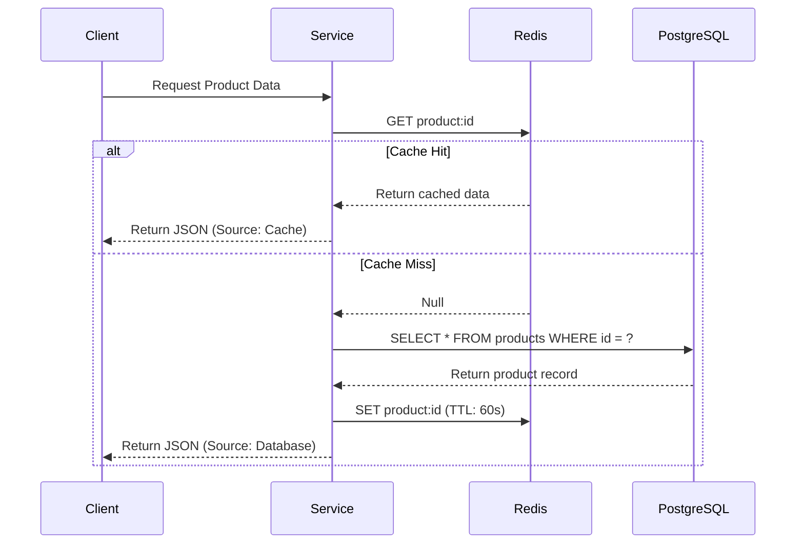
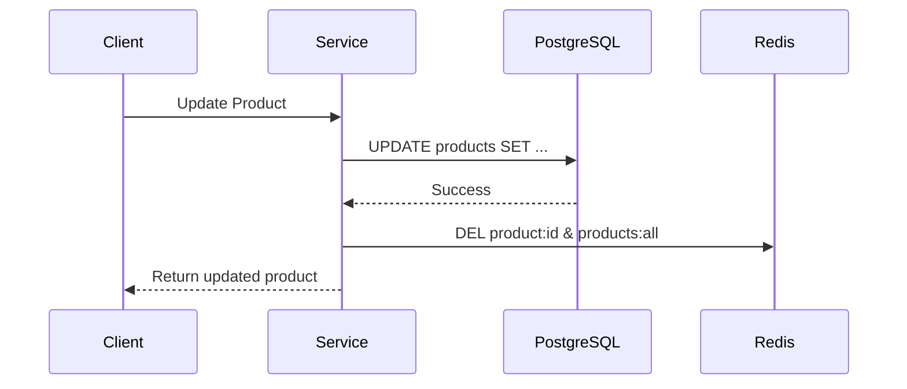

# Node.js Redis Caching Sample

This repository demonstrate a backend-only TypeScript project illustrating how to implement Redis caching with PostgreSQL and Drizzle ORM.

## Features

- **Node.js & TypeScript**: Modern backend development with type safety.
- **PostgreSQL**: Robust relational database for persistent storage.
- **Drizzle ORM**: Lightweight and type-safe ORM for database interactions.
- **Redis Caching**: Improved performance by caching frequent database queries.
- **Docker Support**: Easy environment setup using Docker/Podman Compose.

## Tech Stack

- **Runtime**: Node.js (v22+)
- **Language**: TypeScript
- **Framework**: Express.js
- **ORM**: Drizzle ORM
- **Database**: PostgreSQL
- **Cache**: Redis
- **Containerization**: Podman/Docker Compose

## Caching Strategy: Cache-Aside

The project implements the **Cache-Aside** (Lazy Loading) pattern for data retrieval and **Cache Invalidation** for data modifications.

### Read Flow (GET)



### Write Flow (POST/PUT/DELETE)



## Getting Started

### Prerequisites

- [Node.js](https://nodejs.org/) (v22 or higher)
- [Podman](https://podman.io/) or [Docker](https://www.docker.com/) with Compose

### Installation

1. Clone the repository.
2. Install dependencies:
   ```bash
   npm install
   ```

### Running with Compose (Recommended)

The easiest way to run the project is using the provided compose file:

```bash
podman compose up -d
```
or
```bash
docker-compose up -d
```

This will start:
- A PostgreSQL instance on port `5432`
- A Redis instance on port `6379`
- The Node.js application (if included in compose) on port `3000`

### Local Development

1. Start the infrastructure (Database & Redis):
   ```bash
   podman compose -f docker-compose.dev.yml up -d
   ```

2. Run database migrations:
   ```bash
   npm run db:migrate
   ```

3. Start the development server:
   ```bash
   npm run dev
   ```

## Project Structure

- `src/config`: Database and Redis client configurations.
- `src/db`: Schema definitions and migration scripts.
- `src/services`: Business logic and caching implementation.
- `src/controllers`: Request handling.
- `src/routes`: API route definitions.

## Scripts

- `npm run dev`: Starts the server in development mode using `tsx`.
- `npm run build`: Compiles the TypeScript code to JavaScript in the `dist` folder.
- `npm run start`: Runs the compiled production build.
- `npm run db:generate`: Generates Drizzle migrations.
- `npm run db:migrate`: Executes migrations against the database.
- `npm run db:push`: Pushes schema changes directly to the database.
